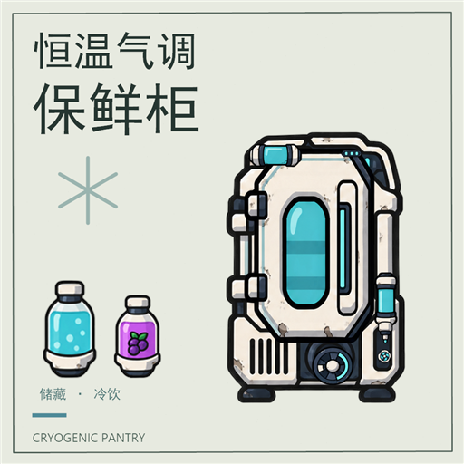
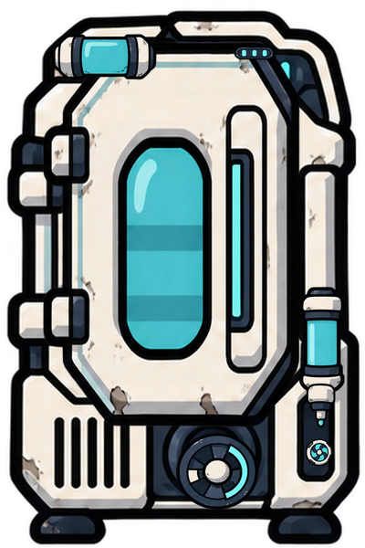

# 恒温气调保鲜柜

**个人开发测试版：请优先使用新建测试存档，不要直接用于重要存档。** 本项目出于个人兴趣开发，上传 GitHub 和创意工坊主要方便作者在不同设备继续开发、同步模组与测试更新。功能、存档和多模组兼容性仍在验证；使用已有存档前，请保留启用本模组之前的独立备份，退订或禁用模组不一定能恢复受影响的存档。

源码仓库：[baiye-gift/BaiyeCryogenicPantry](https://github.com/baiye-gift/BaiyeCryogenicPantry)。
Bug 与建议请提交到 [GitHub Issues](https://github.com/baiye-gift/BaiyeCryogenicPantry/issues)，附游戏/模组版本、DLC 与其他模组、复现步骤、预期/实际表现、截图及 Player.log。更新和修复按个人空闲时间安排，不承诺修复时限。



0.1.3 空管道误停机与停机诊断修复包，面向本机 U59-744825。编译、规则/布局预算、原生托管/配色和素材检查见 CHANGELOG.md；安装及发布状态也以最新日志为准。已根据用户截图与游戏缺字日志修正问题，修正后的完整 Unity/实机验收尚未完成。

原创 2×3 未来食品设施：冷白复合外壳、深蓝结构、青蓝指示、少量边角磨损与部件动作，采用缺氧手绘工业风。食品 500 kg 与饮料 50 kg 独立存储，额外有 2 kg 密封气罐和 20 kg 水缓冲。建筑材料为精炼金属 400 kg + 塑料 200 kg，位于食品建造菜单，解锁科技为“液体温度调节”（LiquidTemperature）。



上图及 `art/processing-preview.gif`、`art/cooling-preview.gif` 是原创部件的合成预览，不是游戏截图。制冷时转子旋转；饮料加工时右侧液管有独立气泡上升、叶轮旋转及喷嘴泵动。管内效果是加工状态动画，不是流体物理或库存液位；上方气罐及门窗反光是静态材质。运行逻辑已接入游戏状态，实际播放仍需实机验收。

## 使用

1. 建在地面上。连接电力（左下，峰值 720 W）和气体输入（左上）。使用原生食品筛选决定接受哪些食物。
2. 在“气调与饮料”的“保鲜”页打开气体选择，直接选择目标，默认为 CO₂；自动补气打开且实际供电后才接入气体。当前罐内气体和目标分别显示。仅支持在 −22°C 能保持气态的原生无菌气体，不接受气态铜/蒸汽；输入气体不得超过50°C且必须处于其气相温度区间。错误或过热气体保留在管内，面板说明原因。
3. 等待食品实际降到深冻温度，并充入至少 0.2 kg 的有效无菌气体；柜内目标 −22°C，页面另显示最暖食品温度。深冻阈值读取每种食物自己的定义，默认严格低于 −18°C。冷空气不能将温热食品直接判为深冻；无菌气氛与食品深冻同时成立时，原生腐败增量为零，不回填新鲜度。
4. 饮料需要 CO₂ 和右下方净水输入。在“饮料”页展开配方，开启生产并设目标份数；食材从食品仓内实际预留，浆果默认保留 20 kg、火椒坚果 10 kg，可在“高级”页调整。三个页签固定在顶部，内容过长时使用右侧滚动条或滚轮。
5. 成品是非热量食品的瓶装冰饮，复制人按休闲作息在柜前取用。一份完成饮用才扣除库存并获得效果；中断返回原瓶。

休闲饮用不要求另建饮料机器。自动清扫器与复制人食物搬运沿用原生存储；饮料仓不挤占食品仓。已预约饮用的一份仍计入 50 kg 容量预算。

## 电力、热量与停机

- 待机 120 W、保温 240 W、主动降温 600 W，生产额外 120 W。工作按照原生电路实际扣除的焦耳结算，部分电力只支付对应工作量。
- 主动制冷上限 240 kDTU/s、保温制冷 96 kDTU/s，内部等效热容 50 kDTU/K、食品换热响应 0.75/s；保温热导 0.008 kDTU/s/K。回归工况为一堆500 kg食品、比热4 kDTU/kg/K、食品/柜内20°C、外壁30°C、足额供电且不开门，包含实际浮点温度和制冷启停，360秒内食品低于−18°C；实际食物比热、进出货、散热和供电会改变速度，尚待实机验证。
- 食物和储藏舱交换真实热量。制冷搬走的热量及实际耗电热量均交给原生建筑温度系统，最终需要玩家处理厨房散热。
- 制冷只受实际供电、启用、自动化及建筑安全条件控制，不要求气体输入管一直有气。空管/断管只影响补气，水中断只影响饮料加工；罐内有效气氛可继续保鲜，空罐时仍可降温但缺少完整保鲜条件。默认输入组件只检查电力，不再自动吸取气体；气体由保鲜柜自己的已付费、筛选及温度检查流程接入。
- 断电停止制冷、补气和生产；已有温度与气氛不立即消失。缺水只影响饮料，气管断开保留已有气体，食物满仓仍可加工已有原料。
- 气氛切换需要真实新气体，目标质量比例达到 95% 后完成，期间两种有效无菌气体仍可保鲜。置换中可以重新选择目标；“取消更换”恢复罐内仍存在的有效旧气体为目标，不还原已消耗的气体，回填仍需要实际供气。旧存档的无效气体目标恢复到有效罐内气体，否则恢复 CO₂；保留全部库存，旧无效气体不会提供无菌效果，待真实来气逐步置换。
- 页面明确提示自动化红信号、未接电线、供电不足、实际运行标志对应的手动禁用/淹没/掩埋/损坏原因或等待实际供电。自动化红信号会停止制冷/补气/生产，需要绿信号或断开自动化线。
- 外部取放按 1 秒门周期合并，气体损耗为现有质量的 1.5%；加工额外损耗为此值的 20%。日常损耗与置换废气是明确的游戏抽象消耗，不向房间排氯气。配方 CO₂、密封损耗、置换损耗分别记账。拆除与彻底损坏通过原生流程释放剩余气体。
- 无菌气氛降低腐败，不清除病菌。原料病菌随实际物品保留并传入成品；饮用走原生病菌摄入路径。

## 四种饮料

每份 1 kg；加工投入与成品质量相同，不增加免费热量或零食。配方气体消耗为 CO₂ 0.03 kg/份。

| 饮料 | 水 | 固体原料 | 时间 | 效果 |
|---|---:|---|---:|---|
| 冰镇苏打水 | 0.97 kg | 无 | 20 s | 士气 +1、压力 −5%/周期，持续 0.5 周期 |
| 浆果汽水 | 0.77 kg | 毛刺浆果 0.20 kg | 25 s | 士气 +3、压力 −10%/周期，持续 0.75 周期 |
| 胡椒气泡饮 | 0.87 kg | 火椒坚果 0.10 kg | 25 s | 运动 +2、操作 +2，持续 0.5 周期 |
| 能量冰饮 | 0.67 kg | 毛刺浆果 0.20 kg + 火椒坚果 0.10 kg | 35 s | 操作/建造/挖掘/运动 +3，持续 0.3 周期；随后操作/运动 −1，持续 0.15 周期 |

所有饮料效果互斥，饮用冷却期为 0.5 周期，能量低谷期间不能继续饮用。饮料是游戏抽象的瓶装冰饮，不提供液体冷却输出。

配方通过 `Baiye.CryogenicPantry.Core.DrinkRecipes.Register(DrinkRecipe)` 扩展，在 prefab 构建前注册并自行提供效果。新增配方默认复用通用瓶装图；可设置 `ItemAnimation`/`ItemClip` 使用自有动画，或令 `RegisterItemPrefab=false` 让第三方自行注册物品，避免重复注册。保鲜气体读取原生 `Rottable.AtmosphereModifier`，第三方气体需在此规则中声明且气相区间覆盖−22°C至50°C；没有写死气体 ID 白名单。不能保证任意修改腐败逻辑的 MOD 自动兼容。

## 构建与验证

需要 .NET 8 SDK 和游戏当前 Managed 目录。工程编译目标 netstandard2.1，包不带游戏 DLL。

```powershell
$managedPath = '<游戏目录>\OxygenNotIncluded_Data\Managed'
dotnet build .\CryogenicPantry.csproj -c Release "-p:GameManaged=$managedPath"
dotnet run --project .\tests\Regression -c Release
dotnet build .\tests\Native\Native.csproj -c Release "-p:GameManaged=$managedPath"
dotnet run --project .\tests\Native -c Release --no-build -- $managedPath
& '<Python>' .\tools\verify-assets.py
.\tools\build-package.ps1 -GameManaged $managedPath -Python '<Python>'
```

Python 素材检查需要 Pillow。重建动画还需要 kanimal-cli：`<Python> tools/build-anims.py --kanimal '<kanimal-cli.exe>'`。源图、部件与 SCML 均在 art/source。构建参数 GameManaged 可替换默认本机路径。

安装包输出 `dist/BaiyeCryogenicPantry-0.1.3.zip` 和 SHA-256。安装时解压 `BaiyeCryogenicPantry` 到游戏 `mods/local`，游戏完全退出后再操作；旧版本先备份。实际安装记录见 CHANGELOG.md。

## 验收边界

编译和托管检查不启动 Unity、SimDLL、复制人 AI 或完整世界存档。尚需 [实机清单](docs/playtest.md) 验证管路与供电、排热、人物动作、饮用效果、面板布局、暂停及真实存读档。效果平衡和其他 MOD 兼容性仍需游戏内观察。运行中移除 MOD 前应先搬出食品；本模组不会永久修改原版食品腐败属性。

设计规范见 DESIGN.md；原始文档在 docs/原始设计文档.md；实际改动和检查见 CHANGELOG.md。

仓库包含源码、测试、原创美术来源及游戏动画资源；游戏本体 DLL、构建缓存、安装备份和本机审计报告不提交。`preview.png` 为512×512工坊封面，与用户确认的第二版保持一致；封面是已有建筑素材的排版，不是游戏截图。
